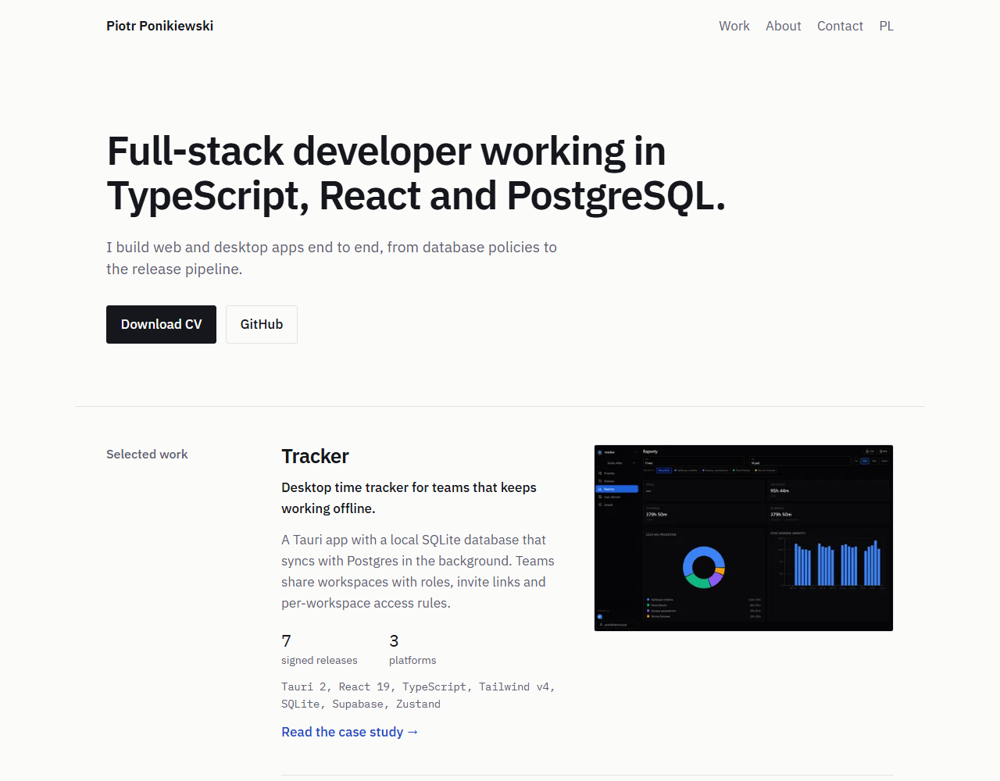
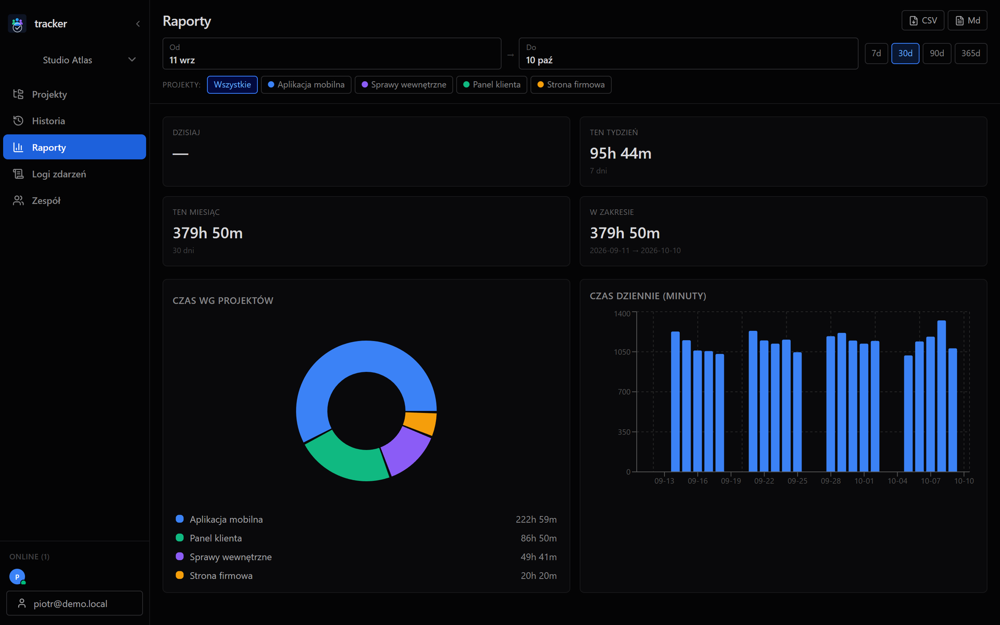
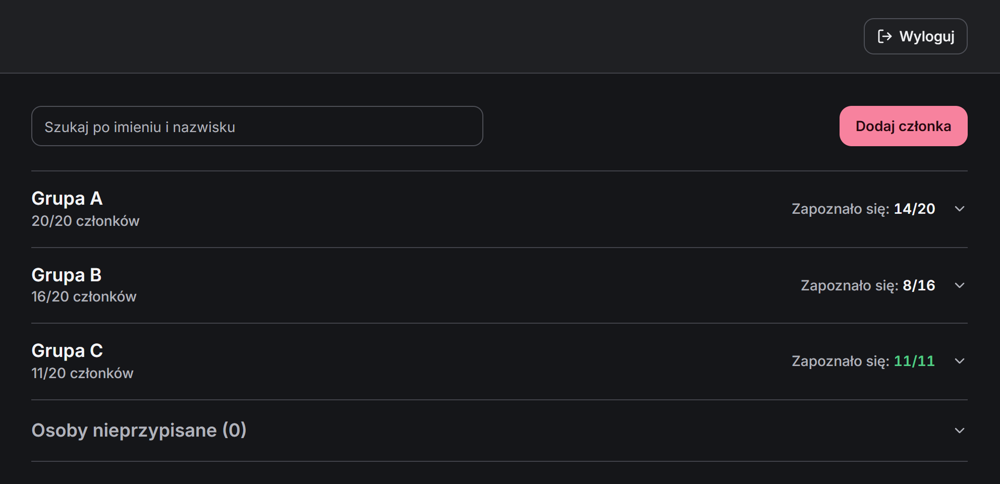
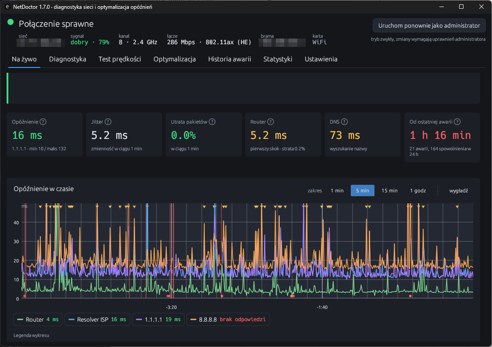

<!-- markdownlint-disable MD033 -->
<div align="center">


# Piotr Ponikiewski

Full-stack developer working in TypeScript, React and PostgreSQL

**[pponikiewski.dev](https://pponikiewski.dev)** &nbsp;·&nbsp; [Wersja polska](https://pponikiewski.dev/pl/) &nbsp;·&nbsp; [Case studies](https://pponikiewski.dev/projects/) &nbsp;·&nbsp; [LinkedIn](https://www.linkedin.com/in/piotr-ponikiewski-580679232/)

[](https://github.com/pponikiewski/Portfolio/actions/workflows/ci.yml)


<br>

<a href="https://pponikiewski.dev">
  <picture>
    <source media="(prefers-color-scheme: dark)" srcset=".github/assets/home-dark.png">
    
  </picture>
</a>

</div>

<br>

My bilingual (EN/PL) portfolio. A fully static Astro site styled like a technical document: real numbers instead of decoration, and no JavaScript sent to the browser.

## Highlights

- **Zero client-side JavaScript.** The only `<script>` on any page is JSON-LD data, and a test fails the build if that changes.
- **Case studies from Markdown.** Each project is one file in a typed content collection. The same frontmatter drives the home page card and the case study.
- **GitHub activity heatmap** rendered to static SVG at build time. A daily rebuild keeps it fresh.
- **Tested on the built output.** `node --test` checks `dist/`: broken links, `alt`/`width`/`height` on images, `hreflang`, structured data, the CV links and the no-script rule.
- **SEO without plugins:** sitemap with `hreflang`, JSON-LD (Person, ProfilePage, TechArticle), social cards and `llms.txt`.
- **Lighthouse (mobile):** Performance 99-100, Accessibility 100, SEO 100.

## Projects on the site

<table>
  <tr>
    <td width="33%" valign="top">
      <a href="https://pponikiewski.dev/projects/tracker/"></a>
      <br><b><a href="https://pponikiewski.dev/projects/tracker/">Tracker</a></b>
      <br>Offline-first desktop time tracker for teams.
      <br><sub>Tauri 2 · React · SQLite · Supabase</sub>
    </td>
    <td width="33%" valign="top">
      <a href="https://pponikiewski.dev/projects/group-manager/"></a>
      <br><b><a href="https://pponikiewski.dev/projects/group-manager/">Group Manager</a></b>
      <br>My engineering thesis, a PWA in production.
      <br><sub>React · Supabase (PostgreSQL) · TanStack Query</sub>
    </td>
    <td width="33%" valign="top">
      <a href="https://pponikiewski.dev/projects/netdoctor/"></a>
      <br><b><a href="https://pponikiewski.dev/projects/netdoctor/">NetDoctor</a></b>
      <br>Finds where the connection breaks and writes a PDF report for the ISP.
      <br><sub>Rust · egui · SQLite</sub>
    </td>
  </tr>
</table>

Also on the site: [Budgie](https://pponikiewski.dev/projects/budgie/), a local-only desktop budget app (in progress).

## Built with

<p>
  
</p>

Astro 5 with TypeScript in strict mode and plain CSS with design tokens. IBM Plex Sans and Plex Mono, one blue accent, hairline rules. Light and dark themes follow the OS setting.

## Quick start

Requires Node 24 and pnpm.

```bash
pnpm install
pnpm run dev        # http://localhost:4321
pnpm run typecheck  # astro check
pnpm run test       # build + checks on dist/
pnpm run build      # type-check + production build to dist/
pnpm run preview    # serve the build
```

Set `GITHUB_TOKEN` (read-only, no scopes) to render the activity heatmap. Without it the section is left out and everything else builds as normal.

## Editing content

| What | Where |
| --- | --- |
| A project (card + case study) | `src/content/projects/<slug>.md` |
| Home page copy, EN and PL | `src/i18n/ui.ts` |
| Contact links | `contact` in `src/i18n/ui.ts` |
| CV | `public/cv/Piotr_Ponikiewski_cv_{en,pl}.pdf` |

Project frontmatter: `featured: false` keeps a project off the home page, `status: in-progress` adds a label, `cover` adds a screenshot. The schema is in `src/content.config.ts`.

<details>
<summary><b>Project structure</b></summary>

```text
src/
  pages/
    index.astro, pl/index.astro   home pages (EN, PL)
    projects/index.astro          all projects
    projects/[slug].astro         case studies
    404.astro, sitemap.xml.ts, llms.txt.ts
  layouts/Base.astro              <head>, meta, social cards, JSON-LD
  components/                     Home, ProjectCard, Activity (heatmap)
  content/projects/*.md           one file per project: card copy + case study
  content.config.ts               project frontmatter schema
  assets/                         portrait and project screenshots (optimized at build)
  i18n/ui.ts                      home page copy (EN + PL)
  lib/github.ts, lib/schema.ts    build-time contributions, JSON-LD
  styles/global.css               tokens, reset, all styles
tests/dist.test.ts                checks the built site
public/                           CV (PDF, PL + EN), og.png, favicons, robots.txt
docs/                             notes, plan, architecture decisions
.github/assets/                   README screenshots
```

</details>

## Deploy and CI

- **Hosting:** Vercel, building from `master`. `vercel.json` sets trailing slashes and the `/en` redirect. The production build needs `GITHUB_TOKEN` for the heatmap.
- **CI** ([`ci.yml`](.github/workflows/ci.yml)): runs `typecheck` and `test` on every push to `master` and on pull requests. No token is passed, so the test checks that the heatmap is left out.
- **Daily rebuild** ([`daily-rebuild.yml`](.github/workflows/daily-rebuild.yml)): calls a Vercel Deploy Hook once a day so the heatmap stays current. Set it as the `VERCEL_DEPLOY_HOOK` repo secret; without it the job skips.

Conventions are in [`CLAUDE.md`](CLAUDE.md), architecture decisions in [`docs/architecture.md`](docs/architecture.md).
