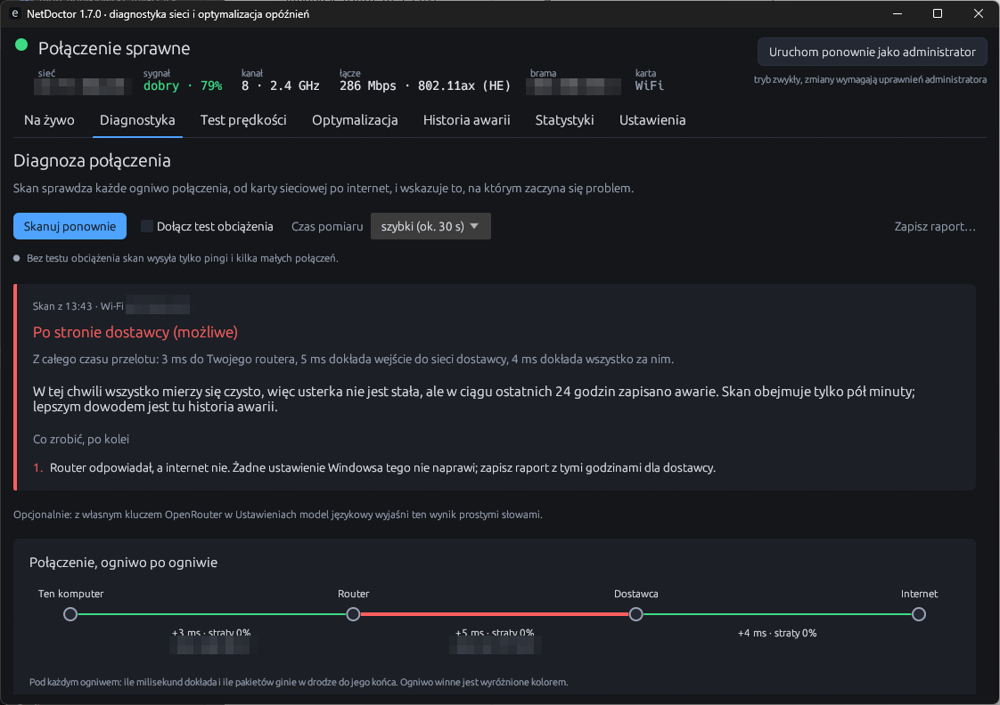
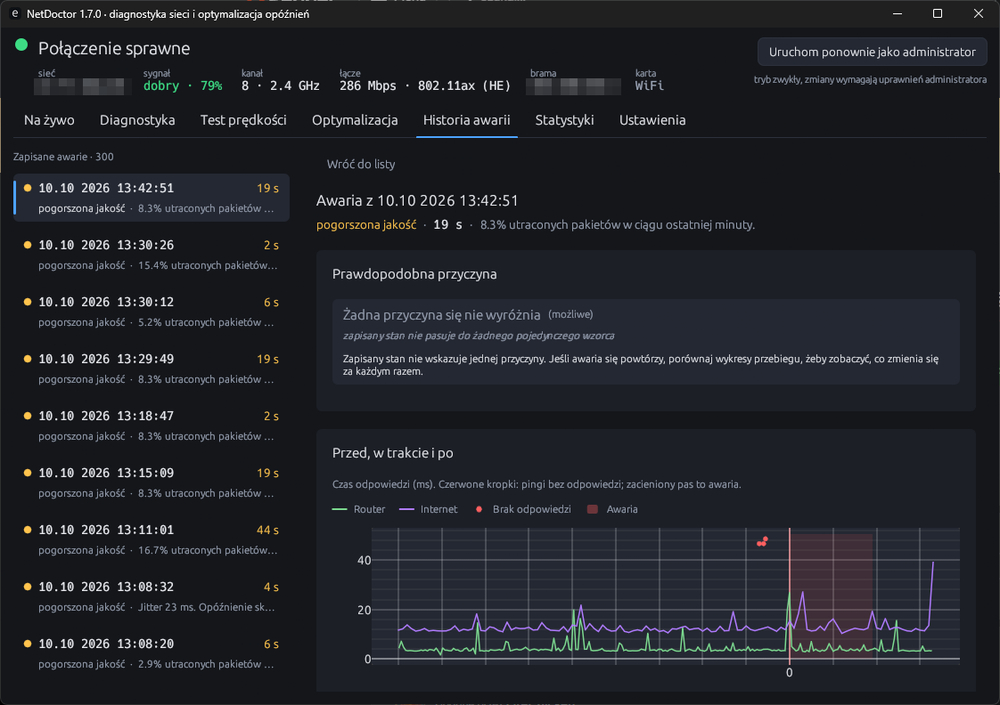

<!-- TODO(piotr): where the idea came from, and why Rust and egui rather than Tauri -->

## The question

From inside Windows every outage looks the same: things stop working. A Wi-Fi card put to sleep and a dead uplink need different fixes, and guessing wrong costs hours. NetDoctor is built around one question: where exactly does the connection break?

## Blame from the pattern

It pings the router and several public addresses at the same time, and reads the verdict off which of them stop answering.

| Router | Internet | Verdict |
| --- | --- | --- |
| answers | answers | working |
| answers | silent | provider |
| silent | silent | between the PC and the router |
| answers | answers, names do not resolve | DNS |

A verdict that something is down needs readings that agree, so one filtered address or one lost DNS reply is not an outage. When no public address answers pings, the app tries TCP connections to port 443 before calling it an outage. DNS is tested against the adapter's resolvers directly, past the Windows cache, which would otherwise answer for a resolver that is gone.

## Evidence over inference

Every outage is written to SQLite together with the state of the connection at that moment (signal, channel, access point, link rate, whether the router still answered) and the three minutes that led up to it. Opening an outage also reads the Windows event logs for that time span. A log entry is the system naming the event, for example an access point dropping a card that Windows had powered down, so it ranks above anything inferred from latency. Only structured fields are read, because Windows translates the message text.

A continuous per-hop trace shows where the trouble starts. A hop is blamed only when its loss carries through to the end of the path: a router that rate-limits replies to its own pings is a setting, not a fault. That finding goes into the PDF report, as the paragraph a support line cannot answer with "restart the router".

## Built to be trusted

- 422 tests cover the blame logic, the statistics, the registry layer, settings migration and ICMP status mapping. Some run against the live machine.
- Polish and English are compiled into the binary. A missing translation is a compile error, not a silent fallback.
- It ships as a single 5 MB executable that updates itself from GitHub Releases. Release builds are code-signed through SignPath.

<!-- TODO(piotr): one thing that surprised you while building it -->
