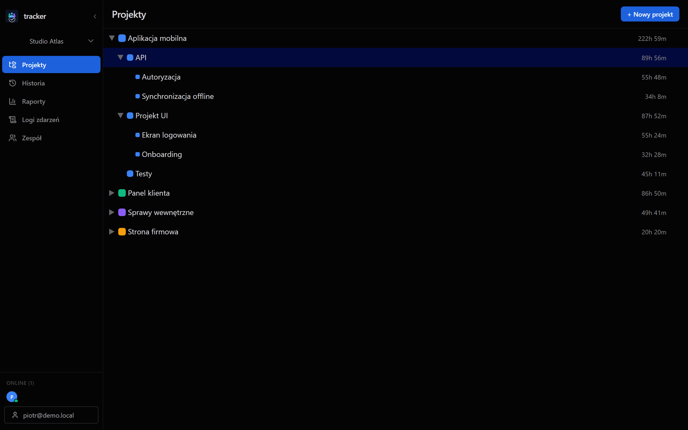
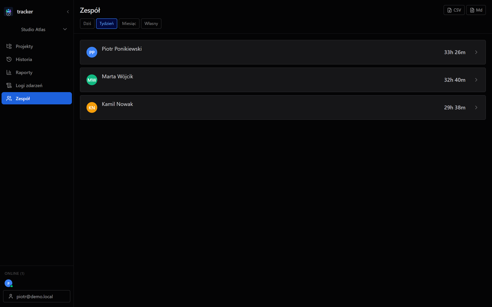

<!-- TODO(piotr): why you built it and who uses it (2-3 sentences, your words) -->

## The problem

Most time trackers assume you are online. Tracker had to work on a laptop with no connection and still give a team one shared view of their hours.

## Local first, cloud second

Every write goes to SQLite on the user's machine first, and the interface reads only from SQLite, so it never waits on the network. Each change is also queued in an outbox. A background worker sends the outbox to Supabase and retries with a backoff capped at five minutes. A write schedules a flush after 250 ms, so with a connection an edit reaches the cloud almost at once.

The other direction is driven by Supabase Realtime: it signals that something changed, and a debounced incremental pull fetches only the rows newer than the last sync.

## Resolving conflicts

When the same row changed on two machines, the newer `updated_at` wins. The merge is a pure function: it takes local rows and cloud rows and returns which rows to write locally and which to push. Equal timestamps are a no-op, so running the merge twice changes nothing. Both properties, correctness and idempotence, are checked with property-based tests in fast-check, which generate random sets of rows instead of a few hand-picked cases.

Last write wins is simple and predictable, and its cost is known: if two people edit the same entry while offline, one edit is lost. In a time tracker an entry normally belongs to one person, so that trade-off is acceptable.

<!-- TODO(piotr): did you consider CRDTs or field-level merge, and why not? -->

## Access per workspace

Workspaces, memberships and roles live in Postgres. Row Level Security filters every synced table by `workspace_id`, so a client can only read and write rows of workspaces it belongs to, whatever the app sends. Invites are links that expire after 72 hours. A personal local workspace is never synced at all.

## Shipping it

Releases are built by GitHub Actions from a version tag, for Windows, macOS and Linux. Update artifacts are signed; the app checks `latest.json` on GitHub Releases and installs an update in one click. Durations are stored as integer minutes, which keeps sums exact, and the input accepts both `1.5h` and `90m`.

<!-- TODO(piotr): what was hardest, what broke, what you would do differently -->
